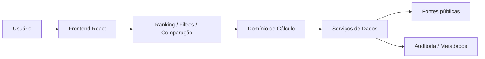

# Arquitetura do Sistema

## 1. Contexto do produto

O produto é uma plataforma web de avaliação pública de deputados e senadores, com nota final em escala de 0 a 10. A nota combina indicadores objetivos e metodologicamente explicáveis, permitindo que o cidadão entenda a atuação parlamentar em contexto comparativo.

A arquitetura deve suportar:

- consulta pública e de baixa fricção
- filtros por cargo, estado, partido e busca por nome
- ranking geral e ranking por critério
- comparação entre parlamentares
- perfil detalhado do parlamentar
- transparência de metodologia e fontes
- evolução futura para ingestão real de bases públicas

## 2. Principais objetivos de arquitetura

### 2.1 Objetivos de negócio

- centralizar e divulgar avaliação pública
- tornar método comparativo e verificável
- personalizar a avaliação conforme a preferência do eleitor
- reduzir ambiguidade na interpretação dos dados

### 2.2 Objetivos técnicos

- manter interface simples e responsiva
- separar regras de cálculo, apresentação e dados
- facilitar manutenção e auditoria
- sustentar crescente volume de parlamentares e critérios
- preparar integração com fonte pública de dados por meio de pipeline controlado

## 3. Princípios arquiteturais

1. Transparência antes da estética
   A interface deve evidenciar metodologia, fontes e contexto antes de detalhes secundários.

2. Separação de responsabilidades
   Presentação, regra de negócio e dados devem estar desacoplados.

3. Dados públicos e rastreáveis
   Cada valor exibido deve ter origem, data de atualização e critério associado.

4. Modularidade
   Componentes e regras devem ser reutilizáveis e independentes por domínio.

5. Evolução incremental
   O sistema deve começar com uma aplicação de front-end e evoluir para backend e pipeline de dados quando a base de informações crescer.

## 4. Visão de alto nível

A arquitetura proposta é baseada em uma solução web de front-end, com o seguinte modelo:

- camada de apresentação: React + Vite
- camada de domínio: regras de cálculo, pesos, normalização e comparação
- camada de serviços: acesso a dados mockados ou via API futura
- camada de dados: fontes públicas estruturadas, versões e metadados de atualização
- camada de auditoria: registro de metodologia, fontes e data de atualização



## 5. Arquitetura em camadas

### 5.1 Camada de apresentação

Responsável pela experiência de navegação e pela comunicação de percepção de confiabilidade.

Inclui:

- Header e navegação
- Hero e contexto do produto
- filtros e busca
- tabela de ranking
- cards de critérios
- metodologia e fontes
- páginas de detalhe e comparação

### 5.2 Camada de domínio

Responsável pelas regras de negócio e cálculo de nota:

- definição de critérios
- pesos por perfil
- escala 0 a 10
- média ponderada
- regra de normalização
- tratamento de dados ausentes

Fórmula principal:

$$
NotaFinal = \frac{\sum (Peso_i \times Nota_i)}{\sum Peso_i}
$$

### 5.3 Camada de serviços

Responsável por encapsular acesso a dados e transformações.

Funções previstas:

- carregar ranking
- buscar parlamentar por ID
- filtrar por estado, cargo, partido
- calcular nota por critério
- mapear fontes e metadados

### 5.4 Camada de dados

Pensada em dois estágios:

- estágio atual: dados mockados em arquivos JS/JSON
- estágio futuro: dados públicos estruturados em banco ou API

Estrutura de dados esperada:

- parlamentar: nome, cargo, UF, partido, legislatura, id
- avaliacao: critério, nota, peso, fonte, data
- referencia: nome da fonte, link, atualização
- metodologia: pesos e regras de cálculo

## 6. Fluxos principais

### 6.1 Fluxo de home

1. Usuário acessa a página inicial
2. Sistema mostra hero, filtros e ranking
3. Ranking é calculado ou carregado previamente
4. Usuário ajusta filtros ou pesquisa
5. Interface recalcula ou reordena os dados

### 6.2 Fluxo de detalhe do parlamentar

1. Usuário clica em um parlamentar
2. Sistema carrega perfil completo
3. Exibe nota geral, critério por critério, histórico e fontes
4. Usuário consulta metodologia e auditoria

### 6.3 Fluxo de comparação

1. Usuário seleciona dois ou mais parlamentares
2. Sistema compara notas e critério por critério
3. Exibe diferenças absolutas e relativas
4. Apresenta destaque de melhor e pior desempenho

### 6.4 Fluxo de personalização

1. Usuário altera pesos por critério
2. Sistema valida soma total igual a 100%
3. Calcula nova nota final em tempo real
4. Exibe resumo comparativo entre perfil base e perfil personalizado

## 7. Modelo de dados dominante

Os dados centrais do domínio são:

- Parlamentar
- Critério de avaliação
- Peso
- Nota por critério
- Ranking
- Fonte pública
- Metodologia
- Atualização

### Entidades sugeridas

```text
Parlamentar
  - id
  - nome
  - cargo
  - partido
  - uf
  - legislatura

Critério
  - id
  - nome
  - descricao
  - pesoPadrao
  - unidade

AvaliacaoParlamentar
  - parlamentarId
  - criterioId
  - nota
  - pesoAplicado
  - fonteId
  - dataColeta

FontePublica
  - id
  - nome
  - tipo
  - url
  - dataAtualizacao
```

## 8. Integrações e fontes de dados

O sistema deve consumir apenas fontes públicas e oficiais, tais como:

- Câmara dos Deputados
- Senado Federal
- Portal da Transparência
- bases de dados abertos
- registros de comissões e votações

### 8.1 Recomendação de integração

A arquitetura correta para a solução é manter um pipeline de ingestão em backend, em vez de permitir que o front-end consulte diretamente as APIs oficiais. A sequência recomendada é:

1. consulta às APIs públicas
2. validação do schema
3. normalização para o modelo do domínio
4. deduplicação e marcação de dados ausentes
5. registro de origem, data e fonte
6. cálculo do ranking e da nota por critério
7. disponibilização por uma API interna para o front-end

Essa estratégia reduz latência, aumenta a rastreabilidade e facilita a reexecução do método quando entradas novas forem publicadas.

### 8.2 Banco de dados recomendado

A melhor escolha para o produto em fase de produção é PostgreSQL. O banco deve armazenar:

- dados públicos crus em tabela de origem
- dados normalizados de parlamentares, critérios e métricas
- histórico de notas e metodologias
- metadados de atualização e fonte
- valores calculados para ranking e comparação

O uso de `JSONB` em estruturas semi-estruturadas do payload de origem é útil, mas a base final deve manter o modelo relacional dominante para permitir auditoria e consistência.

### 8.3 Regra de abstração

O design do sistema deve preservar uma camada de abstração que permita:

- trocar a fonte de dados sem afetar interface
- registrar data de coleta e origem
- tratar ausência de dado com clareza
- manter histórico de metodologia e cálculo
- evoluir para backend sem reescrever a lógica da UI

## 9. Segurança, integridade e auditoria

### 9.1 Segurança

Como se trata de dados públicos, o foco principal não é autenticação de usuário, mas sim:

- integridade dos cálculos
- impossibilidade de alteração indevida dos pesos
- rastreio de origem dos dados
- proteção contra manipulação visual e do front-end

### 9.2 Auditoria

O sistema deve registrar:

- data da coleta
- fonte utilizada
- peso vigente
- versão da metodologia
- autor ou responsável pela atualização

## 10. Requisitos não funcionais atendidos pela arquitetura

### Performance

- renderização leve em front-end
- estrutura modular para reduzir re-renderizações
- carregamento otimizado de listas e filtros

### Usabilidade

- navegação direta e sem excesso de camadas
- linguagem clara e município de informação

### Manutenção

- organização por módulos e separação de regras
- componentes reutilizáveis
- dados centralizados e fáceis de trocar

### Confiabilidade

- metodologia pública e explícita
- coerência entre score no ranking e histórico do parlamentar

## 11. Evolução da arquitetura

### Fase 1: front-end estático

- React + Vite
- dados mockados
- ranking, filtros e metodologia

### Fase 2: camada API

- backend em Node ou Python
- endpoints para ranking, parlamentares e detalhes
- autenticação mínima para administração

### Fase 3: pipeline de dados públicos

- ETL de fontes oficiais
- limpeza, normalização e validação dos dados
- armazenamento em banco
- versionamento da metodologia

### Fase 4: administração e auditoria

- painel administrativo para critérios, pesos e fontes
- revisão de nota qualitativa
- controle de mudanças por versão

## 12. Riscos e alertas

- sobrecarga de informações na página inicial
- inconsistência entre cálculos e documentação
- robustez dos dados públicos insuficiente em algumas métricas
- viés de metodologia se critérios forem mal definidos
- dificuldade de comparação entre parlamentares de diferentes cargos e legislaturas

## 13. Conclusão

A arquitetura proposta combina simplicidade de implementação com rigor metodológico. O front-end atual já está alinhado ao protótipo navegável, enquanto a estrutura pode evoluir para uma plataforma mais robusta, com dados públicos, backend e processo de auditoria, sem perder a clareza e a transparência que tornam o produto confiável.
