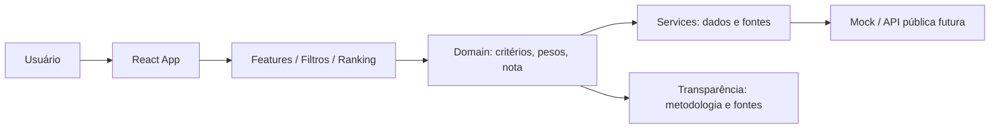

# Arquitetura Spine — Avaliação de Parlamentares

## Paradigma

Aplicação web pública de ranking, com cálculo determinístico em front-end, fontes explícitas e notas comparáveis por perfil do eleitor.

## Invariantes

### AD-1 — Front-end público como camada primária
Binds: a entrega inicial é uma SPA React + Vite e a experiência pública acontece no navegador.
Prevents: acoplamento prematuro de backend, dependência de estado compartilhado e instabilidade de cálculo fora da interface.
Rule: toda tela pública deve funcionar com dados mockados ou servidos por adaptação de dados sem exigir autenticação.

### AD-2 — Separação rígida entre apresentação, domínio e dados
Binds: componentes visuais não executam lógica de negócio; regras de notas e pesos ficam em domínio.
Prevents: drift entre o que o usuário vê e o que a metodologia define, além de recalculações inconsistentes entre telas.
Rule: `src/components/*` apenas renderiza; `src/domain/*` define critérios, pesos, normalização e cálculo; `src/services/*` adapta fonte para o domínio.

### AD-3 — Transparência da metodologia é parte da arquitetura
Binds: cada nota e filtro deve ser explicável por critério, peso, fonte e data de atualização.
Prevents: opacidade, sensação de arbitrariedade e dificuldade de auditoria por parte do eleitor.
Rule: a interface deve expor metodologia, pesos ativos, regra de cálculo e referências sempre que um ranking ou detalhe for exibido.

### AD-4 — Personalização por perfil é central, não opcional
Binds: a nota final varia segundo a prioridade do eleitor, mas a fórmula base permanece estável.
Prevents: comparação inválida entre perfis diferentes e decisões subjetivas escondidas na UI.
Rule: a nota ponderada usa `Σ(Peso_i × Nota_i) / Σ(Peso_i)`, e o sistema deve manter os pesos totais em 100% para qualquer perfil customizado.

### AD-5 — Dados públicos e versionados são a base de confiança
Binds: cada dado de parlamentar, critério e fonte deve ter origem e data de atualização registradas.
Prevents: uso de números sem rastreabilidade, bases inconsistentes e reuso indefinido de dados antigos.
Rule: toda fonte exibida deve ter origem oficial e o sistema deve manter metadados mínimos de coleta, versão e atualização.

### AD-6 — Fronteira de expansão: mock atual, pipeline futuro
Binds: a solução começa com dados em JSON/fixtures e prepara uma camada de serviço para API real.
Prevents: dependência de um backend inexistente e acoplamento do front-end a um esquema definitivo cedo demais.
Rule: a camada de serviços deve abstrair a origem da informação; o modelo de domínio não deve conhecer detalhes de JSON bruto ou API externa.

### AD-7 — O ranking é uma vista sobre um conjunto dominante de entidades
Binds: os dados centrais do sistema são parlamentar, critério, peso, nota, ranking, fonte e metodologia.
Prevents: divergência entre entidades e visualizações; uso de campos improvisados em componentes.
Rule: qualquer nova tela deve respeitar o modelo dominante e não duplicar dados relevantes fora do domínio.

### AD-8 — Integração por pipeline de dados, não por consulta direta do front-end
Binds: as APIs oficiais devem ser consumidas por uma camada de integração em backend e não pela UI pública.
Prevents: instabilidade, rate limiting, inconsistência de origem e baixa rastreabilidade da informação.
Rule: a interface pública deve receber dados já normalizados e auditáveis por origem, data e metodologia.

### AD-9 — PostgreSQL como banco principal para produção
Binds: o sistema precisa de persistência relacional, histórico e auditoria de fontes e cálculos.
Prevents: perda de integridade, dificuldade de reprocessamento e acoplamento do modelo a estruturas improvisadas.
Rule: o banco principal deve preservar dados brutos, dados normalizados e metadados de atualização, com apoio de `JSONB` somente para payloads semi-estruturados.

## Seed

### Stack
- React 18
- Vite 5
- JavaScript
- CSS modular via tokens/estilos globais

### Estrutura dominante

```text
react-app/src/
├── app/
├── components/
├── config/
├── data/
├── domain/
├── features/
├── services/
└── styles/
```

### Limites de responsabilidade
- `components`: apresentação e composição visual
- `features`: orchestration de tela e interações por funcionalidade
- `domain`: regras de cálculo, pesagem, filtros e validação
- `services`: adaptação de dados e integrações futuras
- `data`: fixtures e dados de referência

### Fluxo principal



## Deferred

- autenticação e perfis de usuário persistidos
- backend próprio para armazenamento e auditoria
- pipeline automatizado de ingestão de dados públicos
- gateway de dados com versionamento de metodologia por legislatura
- painel administrativo de curadoria e revisão de pesos
- cálculo qualitativo automatizado com apoio de modelos ou curadoria editorial

## Observações finais

A arquitetura é deliberadamente enxuta: ela firma as invariantes que impedem divergência entre módulos e evita decidir cedo sobre infraestruturas que ainda não são necessárias. A mesma convenção permite evolução para backend e ingestão real sem quebrar o modelo de cálculo e a transparência da experiência pública.
