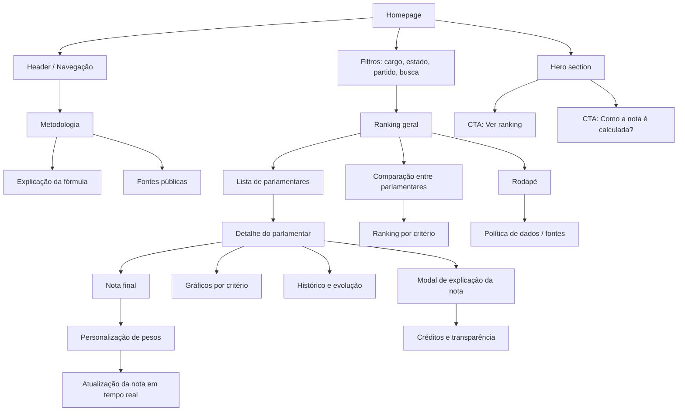

# Fluxograma da navegação da interface

## Visão geral

Este fluxograma descreve a jornada principal do usuário na plataforma de avaliação de parlamentares, desde a entrada na homepage até a comparação e a personalização da nota.

## Descrição da jornada

### 1. Entrada na homepage
- O usuário chega na página inicial e entende rapidamente o objetivo do produto.
- Há destaque para a nota final, filtros e rastreio da metodologia.

### 2. Busca e filtros
- O usuário busca um parlamentar ou seleciona filtros por cargo, estado e partido.
- O sistema atualiza a lista do ranking de forma imediata.

### 3. Ranking geral
- O usuário visualiza a classificação por nota final.
- A lista apresenta as informações principais para identificação rápida do parlamentar.

### 4. Detalhamento do parlamentar
- Ao selecionar um parlamentar, o usuário acessa a ficha detalhada.
- Há nota geral, evolução, critérios e fontes.

### 5. Personalização
- O eleitor pode ajustar pesos conforme prioridades pessoais.
- A nota é recalculada em tempo real para refletir a nova configuração.

### 6. Transparência e metodologia
- O usuário pode acessar a lógica de cálculo, critérios e fontes públicas.
- Isso reforça a credibilidade da avaliação.

## Objetivo do fluxograma

Mostrar a lógica da navegação de forma simples, priorizando:
- leitura rápida
- transparência
- comparação objetiva
- entendimento da metodologia

